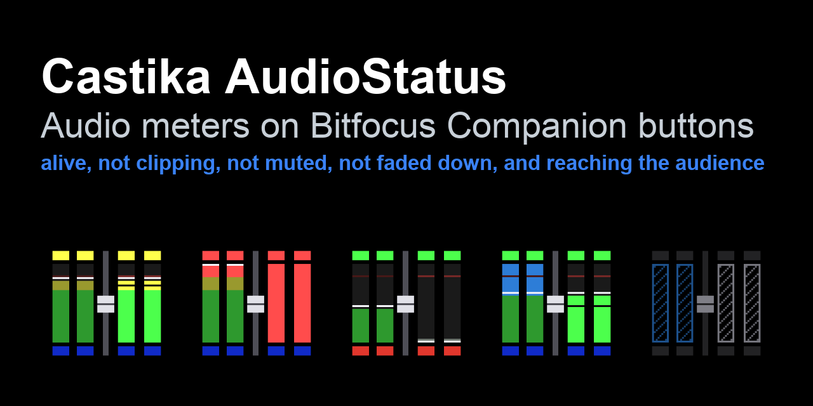

# Castika AudioStatus

Display the state of your audio directly on Bitfocus Companion buttons, read from OBS Studio or from a Blackmagic ATEM switcher. One glance tells a broadcaster that program audio is alive, not clipping, unmuted, not faded down, and reaching the audience. The last three look perfectly healthy on the mixer in front of you and reach nobody watching.

## Requirements

- Bitfocus Companion 5.
- OBS Studio 28 or later with its WebSocket server enabled. That server is obs-websocket 5, built into OBS from 28 onward, and it listens on port 4455 by default.
- Or a Blackmagic ATEM switcher with Fairlight audio, reachable over the network. It needs nothing enabled and no password, and the module only listens.

## Installation

Download `castika-audiostatus-<version>.tgz` from this repository's Releases page. In Companion, open Modules, choose Import module package, and select that file.
Version 2 renamed the module. A connection made with version 1 does not carry over and has to be made again.

Connection setup, placing a meter on a button and reading one are in `companion/HELP.md`, which Companion shows as the connection's own help. They are not repeated here.

## Building from source

Only a developer needs this. With yarn 4 and Node 22 or later, `./build.sh` runs the build outside the source folder so nothing is left behind in it, and brings back two files: the finished `.tgz`, which is a release asset and is not committed, and an updated `yarn.lock`.

## Project structure

- `src/source.js`: the contract an audio source answers, with the edge cases that are easy to get wrong.
- `src/sources/obs.js`: the OBS adapter, holding the inputs, the routing, the filters, the stream's track and the mix.
- `src/sources/obswebsocket.js`: the transport under it, the obs-websocket 5 protocol and nothing more.
- `src/sources/atem.js`: the switcher adapter, holding the Fairlight channels, the faders, the processing stages, the tally and the switcher's own mix.
- `src/sources/atemprotocol.js`: the transport under it, the switcher's packets and their acknowledgements and nothing more.
- `src/draw.js`: the picture, from the bars and the fader to the colors, the scales and the layout across buttons.
- `src/ballistics.js`: how a meter moves, with the OBS mixer's own constants.
- `src/group.js`: which buttons belong to one meter.
- `src/png.js`: a hand written PNG encoder, which keeps the module to a single dependency.
- `src/main.js`: the Companion wiring, from the settings and the feedback to the presets, the upgrade scripts and the repaint loop.
- `src/entry.mjs`: what Companion imports, and the one reason it is ES.
- `companion/manifest.json`: what Companion reads before any of it runs. Its `version` and its `runtime.apiVersion` are both overwritten as the package is built, so the version is raised in `package.json` alone.

A further machine means a new file under `src/sources/` rather than a change to the drawing. It is not free: the connection settings in `src/main.js` name each machine's fields one machine at a time, so a new adapter needs its own fields there too.

## What the module cannot know

OBS reports a level for every active input and publishes none for the final mix, because it has no master bus to meter. On an OBS connection `PGM-MIX` is therefore an estimate rather than a reading: a root sum of squares over the inputs that feed the track the stream sends. Membership is exact, since the stream's track and each input's routing can both be read, and the values summed are past the fader and the mute. Only the arithmetic approximates, because adding signals that way assumes they are unrelated, and phase can carry a real peak about three decibels either way. Where a request for an OBS input's mute, fader or audio track fails, the module carries on with unmuted, unity gain, and the stream's own track, and nothing on the button says so. A switcher meters its own output, so there the mix is a reading, and the one thing it cannot settle is a channel whose audio follows its video: that needs the video's tally, and where the switcher has said nothing about it the channel is taken to be reaching the mix.

## License and problems

MIT. See LICENSE. Open an issue on this repository to report a problem.
